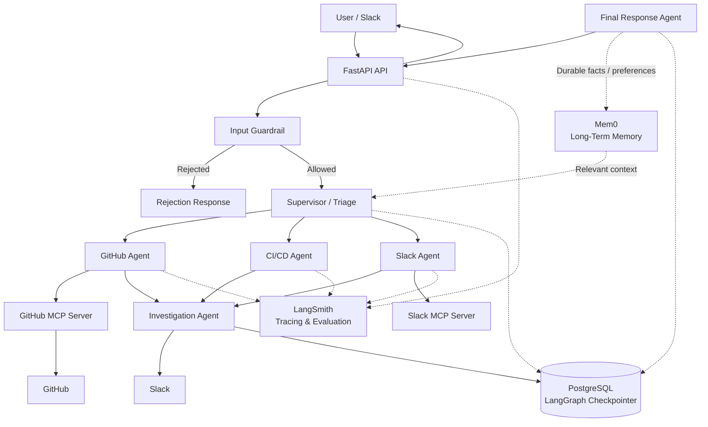

# ForgeOps

ForgeOps is an AI-powered engineering and DevOps investigation assistant. It connects to GitHub, Slack, and CI/CD systems to investigate incidents, determine root causes, and provide structured answers — all without requiring manual log-hunting across multiple systems.

## Architecture



## Architecture Overview

| Component | Responsibility |
|-----------|---------------|
| **FastAPI API** | Entry point. Receives user queries via `/query` and returns structured investigation results. |
| **Input Guardrail** | Classifies requests as `allow`, `reject`, or `clarify`, and categorizes them (`github`, `ci_cd`, `slack`, `cross_source_investigation`, etc.). |
| **Supervisor / Triage** | Reads the guardrail verdict and decides which specialist agents to invoke. Writes per-agent queries. |
| **GitHub Agent** | Investigates repositories, PRs, commits, diffs, and code via the GitHub MCP server. |
| **CI/CD Agent** | Investigates GitHub Actions workflows, runs, jobs, and job logs via the GitHub Actions MCP server. |
| **Slack Agent** | Investigates Slack channels, threads, and users via the Slack MCP server. |
| **Investigation Agent** | Correlates findings from all specialist agents to determine root cause. |
| **Finalizer Agent** | Transforms investigation state into a structured, user-facing response (summary, root cause, evidence, recommended action, limitations). |
| **Memory Agent** | Extracts durable, reusable facts from completed investigations for long-term storage in mem0. |
| **Mem0** | Long-term memory store (Qdrant vector store) for durable engineering facts. |
| **PostgreSQL** | LangGraph checkpointer for conversation/state persistence. |
| **LangSmith** | Tracing and evaluation for all LLM calls. |

## Quick Start

### Prerequisites

- Docker and Docker Compose
- A `.env` file with the required API keys (see below)

### 1. Configure Environment

Copy `.env.example` to `.env` and fill in your values:

```bash
cp .env.example .env
```

Required variables:

| Variable | Description | Required |
|----------|-------------|----------|
| `GROQ_API_KEY` | Groq API key (used for FINAL_MODEL and MEMORY_MODEL) | Yes |
| `OPENROUTER_API_KEY` | OpenRouter API key (used for GITHUB_MODEL, SLACK_MODEL, CI_CD_MODEL, SUPERVISOR_MODEL, INVESTIGATION_MODEL, GUARDRAIL_MODEL) | Yes |
| `GITHUB_ACCESS_TOKEN` | GitHub Personal Access Token (for GitHub MCP server) | Yes |
| `SLACK_BOT_AUTH_TOKEN` | Slack Bot Token (for Slack MCP server) | Yes |
| `SLACK_TEAM_ID` | Slack Team ID (for Slack MCP server) | Yes |

### 2. Build and Run

Using Docker Compose (recommended):

```bash
docker compose up --build
```

Or run manually:

```bash
docker build -t forgeops .

docker run -p 8000:8000 \
  -v /var/run/docker.sock:/var/run/docker.sock \
  --env-file .env \
  forgeops
```

The API will be available at `http://localhost:8000`.

### 3. Test the API

**Health check:**

```bash
curl http://localhost:8000/health
```

**Run an investigation:**

```bash
curl -X POST http://localhost:8000/query \
  -H "Content-Type: application/json" \
  -d '{"user_query":"Why did GitHub Actions workflow run 37852919557 fail in AllenGeorge08/LLM-Semantic-Caching-Gateway?", "thread_id":"my-thread-1"}'
```

**Response format:**

```json
{
  "thread_id": "supervisor-test-6",
  "status": "completed",
  "guardrail": {
    "decision": "allow",
    "category": "cross_source_investigation",
    "reason": "The request asks to investigate a GitHub Actions workflow run failure..."
  },
  "investigation_plan": "Investigate the failed workflow run and its logs...",
  "selected_agents": ["github", "cicd", "slack"],
  "final_response": {
    "summary": "...",
    "root_cause": "...",
    "evidence": ["..."],
    "recommended_action": ["..."],
    "limitations": null
  },
  "errors": []
}
```

## Architecture Details

### Data Flow

1. **User** submits a query via `POST /query`
2. **Guardrail** classifies the request (allow/reject/clarify + category)
3. **Supervisor** decides which specialist agents to invoke based on the guardrail category
4. **Specialist agents** (GitHub, CI/CD, Slack) run in parallel and collect evidence
5. **Investigation Agent** correlates findings from all agents and determines root cause
6. **Finalizer Agent** synthesizes the final user-facing response
7. **Memory Agent** extracts durable facts for long-term storage in mem0

### State Flow

The system uses LangGraph `StateGraph` with `ForgeOpsState` as the shared state. Each agent node reads from and writes to the state:

| State Field | Description |
|-------------|-------------|
| `user_query` | The user's original question |
| `thread_id` | Conversation thread ID |
| `guardrail_allowed` | Whether the guardrail allowed the request |
| `guardrail_category` | The guardrail classification |
| `selected_agents` | Which specialist agents were invoked |
| `agent_queries` | Per-agent query strings |
| `investigation_plan` | The supervisor's plan |
| `github_findings` | Findings from the GitHub agent |
| `slack_findings` | Findings from the Slack agent |
| `ci_cd_findings` | Findings from the CI/CD agent |
| `investigation` | The investigation agent's narrative |
| `root_cause` | The determined root cause |
| `evidence` | List of evidence statements |
| `proposed_action` | Recommended action |
| `final_response` | The final user-facing response |
| `errors` | Any errors encountered |
| `memory_context` | Durable memories extracted |

## Project Structure

```
forgeops/
├── app/
│   ├── api/
│   │   └── app.py          # FastAPI application with /query and /health endpoints
│   ├── agents/
│   │   ├── github_agent.py         # GitHub repository investigation
│   │   ├── github_ci_agent.py      # CI/CD workflow investigation
│   │   ├── slack_agent.py          # Slack investigation
│   │   ├── investigation_agent.py  # Cross-agent correlation & root cause
│   │   ├── finalizer_agent.py      # Final user-facing response
│   │   ├── memory_agent.py         # Durable memory extraction
│   │   ├── supervisor_agent.py     # Agent routing & triage
│   │   └── prompts.py              # All agent prompts
│   ├── config/
│   │   └── config.py               # LLM model configuration
│   ├── graph/
│   │   └── __init__.py             # LangGraph StateGraph wiring
│   ├── guardrails/
│   │   ├── guardrails.py           # Input guardrail
│   │   └── prompts.py              # Guardrail prompts
│   └── mcp/
│       ├── client.py               # MCP client setup
│       ├── github.py               # GitHub MCP wrapper
│       ├── github_actions.py       # GitHub Actions MCP wrapper
│       └── slack.py                # Slack MCP wrapper
│       └── tools/
│           ├── github_tools.py     # Read-only GitHub tool wrappers
│           ├── github_actions_tools.py  # CI/CD tool wrappers
│           └── slack_tools.py      # Slack tool wrappers
├── tests/
│   ├── agents/
│   │   ├── test_github_agent.py
│   │   ├── test_cicd_agent.py
│   │   ├── test_investigation_agent.py
│   │   ├── test_slack_agent.py
│   │   └── test_guardrail_agent.py
│   └── api/
│       └── test_api.py
├── app/static/
│   ├── index.html          # Frontend UI
│   ├── style.css           # Styles
│   └── app.js              # Frontend logic
├── Dockerfile              # Production Docker image
├── docker-compose.yml      # Docker Compose configuration
├── .env.example            # Environment variable template
├── .gitignore              # Git ignore rules
├── pyproject.toml          # Project configuration
└── README.md               # This file
```

## API Endpoints

### `GET /` / `GET /health`

Health check endpoint.

**Response:**
```json
{"status": "healthy", "service": "forgeops"}
```

### `POST /query`

Run a ForgeOps investigation.

**Request:**
```json
{
  "user_query": "Why did GitHub Actions workflow run 37852919557 fail in AllenGeorge08/LLM-Semantic-Caching-Gateway?",
  "thread_id": "optional-thread-id"
}
```

**Response:**
```json
{
  "thread_id": "supervisor-test-6",
  "status": "completed",
  "guardrail": {
    "decision": "allow",
    "category": "cross_source_investigation",
    "reason": "..."
  },
  "investigation_plan": "...",
  "selected_agents": ["github", "cicd", "slack"],
  "final_response": {
    "summary": "...",
    "root_cause": "...",
    "evidence": ["..."],
    "recommended_action": ["..."],
    "limitations": null
  },
  "errors": []
}
```

## Development

### Running Tests

```bash
pytest tests/ -v
```

Or run specific test suites:

```bash
make test-api
make test-guardrail
make test-cicd
make test-slack
make test-investigation
make test-memory
```

### Adding a New Agent

1. Create a new agent module in `app/agents/`
2. Add the agent to `app/graph/__init__.py` (import + node + edge)
3. Add routing logic to `app/agents/supervisor_agent.py` if needed
4. Add tests in `tests/agents/`

## License

MIT