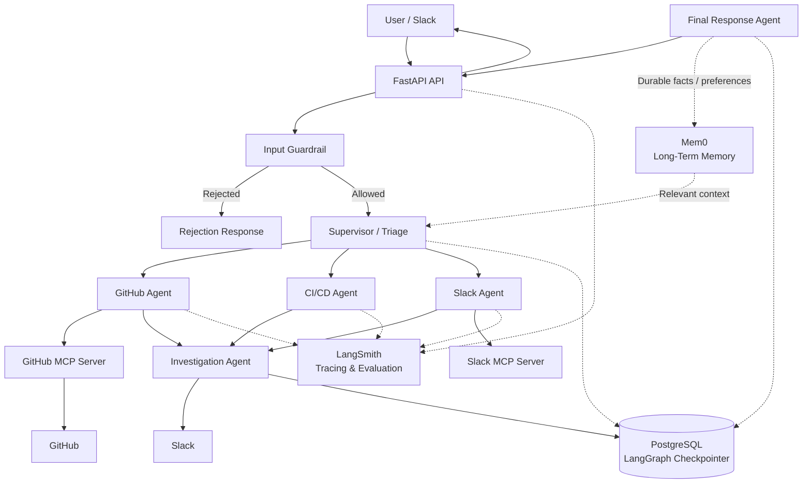

Running Tests:
```python
pytest tests/agents/ -s -v
```

# Docker Instructions

Build and run with Docker Compose (injects secrets from `.env` and mounts
the Docker socket so the GitHub MCP server can run inside the container):

```bash
docker compose up --build
```

Or build and run manually:

```bash
docker build -t forgeops .

docker run -p 8000:8000 \
  -v /var/run/docker.sock:/var/run/docker.sock \
  --env-file .env \
  forgeops
```

Required environment variables (copy `.env.example` to `.env` and fill in):

- `GROQ_API_KEY` — Groq API key for supervisor/finalizer/investigation models
- `OPENROUTER_API_KEY` — OpenRouter API key for GitHub/Slack/CI-CD models and embeddings
- `GITHUB_ACCESS_TOKEN` — GitHub personal access token (for GitHub MCP server)
- `SLACK_BOT_AUTH_TOKEN` — Slack bot token (for Slack MCP server)
- `SLACK_TEAM_ID` — Slack team ID (for Slack MCP server)

The API will be available at `http://localhost:8000`:

- `GET /` — health check
- `POST /query` — run a ForgeOps investigation
